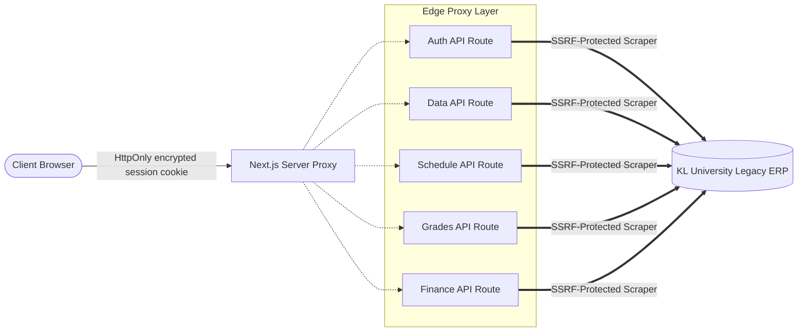

<div align="center">
  <h1>KL Sync</h1>
  <p><strong>The Enterprise-Grade KL University ERP Client</strong></p>

  <p>
    
    
    
    
  </p>
  <p>
    <a href="https://github.com/tejaswin-amara/kl-sync/actions/workflows/ci.yml">
      
    </a>
    
  </p>
</div>

## Overview

Welcome to **KL Sync**, the premier source-available **KL University ERP client** designed for performance, security, and unparalleled user experience. This modern **student portal** uses a server-side proxy to communicate with the legacy ERP infrastructure while keeping ERP session material out of browser-readable storage. As a highly optimized **Next.js dashboard**, KL Sync offers a suite of essential tools including a real-time **attendance tracker**, an accurate **CGPA calculator**, and secure academic data access—all delivered at edge speeds with uncompromising reliability.

## Architecture

KL Sync uses a Next.js server-side proxy to orchestrate requests to the legacy KL University ERP. It does not persist student records in an application database. Short-lived Redis entries support distributed rate limiting and one-time CAPTCHA/session replay protection.



## Quickstart

Get up and running locally in minutes:

1. **Clone the repository**

   ```bash
   git clone https://github.com/tejaswin-amara/kl-sync.git
   cd kl-sync
   ```

2. **Install dependencies**

   ```bash
   npm install
   ```

3. **Configure environment variables**

   ```bash
   cp .env.example .env.local
   # Update .env.local with your SESSION_SECRET
   ```

4. **Start the development server**

   ```bash
   npm run dev
   ```

5. **Access the application**
   Open [http://localhost:3000](http://localhost:3000) in your browser.

## Dashboard Module Suite

KL Sync features 11 comprehensive modules tailored for the modern student experience:

| Module           | Route                   | Icon Primitive  | Key Features                                |
| ---------------- | ----------------------- | --------------- | ------------------------------------------- |
| **Overview**     | `/dashboard`            | `home-icon`     | At-a-glance academic summary, alerts        |
| **Attendance**   | `/dashboard/attendance` | `clock-icon`    | Real-time tracking, low-attendance warnings |
| **Timetable**    | `/dashboard/timetable`  | `calendar-icon` | Weekly schedule, classroom locations        |
| **Marks**        | `/dashboard/marks`      | `chart-icon`    | Grades breakdown, CGPA calculator           |
| **Profile**      | `/dashboard/profile`    | `user-icon`     | Personal details, biometric info            |
| **Fee**          | `/dashboard/fee`        | `wallet-icon`   | Payment history, pending dues, receipts     |
| **Tools**        | `/dashboard/tools`      | `wrench-icon`   | AI Copilot, utility calculators             |
| **Circulars**    | `/dashboard/circulars`  | `bell-icon`     | Official announcements, notifications       |
| **Hostels**      | `/dashboard/hostels`    | `building-icon` | Room allocation, mess menus                 |
| **Library**      | `/dashboard/library`    | `book-icon`     | Issued books, due dates, catalog            |
| **Exam Seating** | `/dashboard/seating`    | `seat-icon`     | Room numbers, seating charts                |

## Security Architecture

Security is built-in by design, utilizing the "Ponytail Philosophy" (zero bloat, relying on standard library primitives):

- **Encrypted session cookies**: ERP session data is encrypted with AES-GCM and returned only in a `HttpOnly; Secure (in production); SameSite=Lax` cookie. Browser JavaScript cannot read the cookie.
- **Cookie-only authentication**: ERP API routes do not accept session IDs in request bodies, query strings, or custom authentication headers.
- **CAPTCHA separation**: The university image code is kept in a short-lived HttpOnly session cookie and is consumed once. CapJS browser proof-of-work is a separate challenge and is independently validated.
- **Replay/rate-limit controls**: Redis stores only hashed, short-lived CAPTCHA/session replay keys and rate-limit counters. Production fails closed when Redis is missing or unavailable; local development uses in-memory fallbacks.
- **SSRF protection**: Strict URL parsing and whitelisting at the proxy layer prevent Server-Side Request Forgery.
- **No student database**: KL Sync does not persist student records in an application database.


## Login and CAPTCHA flow

The login page uses two independent checks:

1. **University image security code**: KL Sync fetches the ERP image and keeps the encrypted ERP challenge session in a short-lived, HttpOnly cookie. The challenge can be used for one login attempt only. Enter the code manually or use the optional [KLU ERP Auto-Fill extension](https://github.com/tejaswin-amara/klu-erp-autofill), which performs local on-device recognition and fills the field for review. It does not submit the form.
2. **CapJS browser verification**: The visible widget obtains a proof-of-work challenge from `/api/captcha/challenge` and redeems it through `/api/captcha/redeem`. The resulting short-lived proof is validated separately by the login API.

Neither CAPTCHA answer nor ERP session identifier is returned to browser JavaScript. A failed or expired challenge requires a fresh image and a fresh browser proof. In production, configure Upstash Redis before deployment; the app rejects protected requests rather than silently using per-instance in-memory replay controls.

## Environment Variables

| Variable              | Description                                      | Requirement                |
| --------------------- | ------------------------------------------------ | -------------------------- |
| `SESSION_SECRET` | 32-byte or longer secret for AES-GCM ERP session encryption | **Required** in production |
| `CAP_SECRET` | Separate secret for CapJS challenge signing; falls back to `SESSION_SECRET` when unset | Recommended |
| `UPSTASH_REDIS_REST_URL` | Upstash Redis REST endpoint for CAPTCHA replay protection and distributed rate limiting | **Required** in production |
| `UPSTASH_REDIS_REST_TOKEN` | Upstash Redis REST bearer token | **Required** in production |
| `OPENAI_API_KEY` | Key for the AI Copilot features | Optional |
| `TRUST_PROXY_HEADERS` | Trust forwarded client IP headers outside Vercel | Optional |

## Quality Gates

Our CI/CD pipeline enforces rigorous standards before any code reaches production:

- **Typecheck**: Strict TypeScript 5.8 validation (`tsc --noEmit`).
- **Lint**: ESLint + Next.js core web vitals strict mode.
- **Unit and integration tests**: native `node:test` suites covering API boundaries, CAPTCHA replay controls, session handling, and feature behavior.
- **Browser tests**: Playwright flows covering responsive login, CAPTCHA refresh, demo access, and application navigation.
- **Agent-as-Judge**: AI evaluation suites for Copilot responses and semantic behavior.
- **Build**: Turbopack production compilation.

## Tech Stack Defaults vs Alternatives matrix

Guided by the "Ponytail Philosophy", we prioritize zero-dependency standard libraries over bloated packages.

| Category           | KL Sync Choice                 | Alternative              | Rationale                                                         |
| ------------------ | ------------------------------ | ------------------------ | ----------------------------------------------------------------- |
| **Framework**      | Next.js 16 (App Router)        | Remix / SvelteKit        | Superior edge-runtime support and Turbopack ecosystem.            |
| **State**          | Native hooks + sessionStorage  | SWR / TanStack Query     | YAGNI; standard React hooks are sufficient for a stateless proxy. |
| **Styling**        | Tailwind CSS v4 + Vanilla CSS  | CSS Modules / Styled     | Unmatched utility-first speed without runtime overhead.           |
| **Icons**          | Native zero-runtime SVG engine | lucide-react / heroicons | 57 hand-crafted primitives yield zero bundle size bloat.          |
| **Validation**     | Zod                            | Yup / io-ts              | TypeScript-first schema validation required for AI tool calling.  |
| **Testing**        | native `node:test`             | Jest / Vitest            | No external dependencies, blazingly fast execution.               |
| **Scraping**       | Cheerio                        | Puppeteer / jsdom        | Lightweight HTML parsing without headless browser overhead.       |
| **AI**             | Vercel AI SDK                  | LangChain                | First-class Next.js integration for Edge streaming.               |
| **Crypto**         | Web Crypto API                 | crypto-js                | Native performance and security without NPM vulnerabilities.      |
| **Bot Protection** | CapJS (PoW)                    | reCAPTCHA / Turnstile    | Privacy-friendly, zero-friction proof-of-work.                    |

## Documentation Links

- [Development Guide](./docs/development.md)
- [Architecture Blueprint](./docs/architecture.md)
- [Security Model](./docs/security.md)

## License & Disclaimer

**Proprietary License**  
Copyright © 2026 Tejaswin Amara. All rights reserved.  
This software is source-available but **not open source** (NOT MIT). You may view the source code, but you may not copy, distribute, modify, or use it for commercial purposes without explicit written permission from the author.

This project is an independent client and is **not affiliated with, endorsed by, or connected to KL University**.

---

<div align="center">
  Crafted with ❤️ by Tejaswin
</div>
